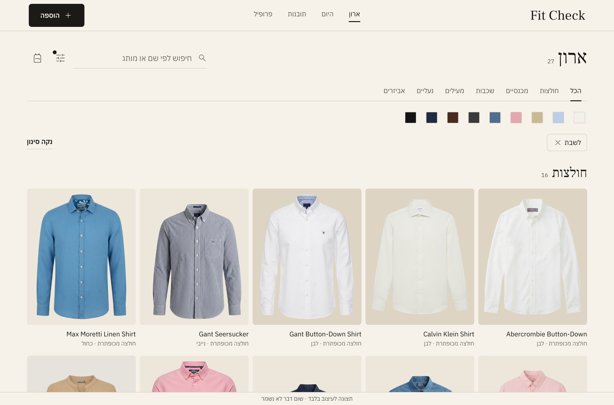
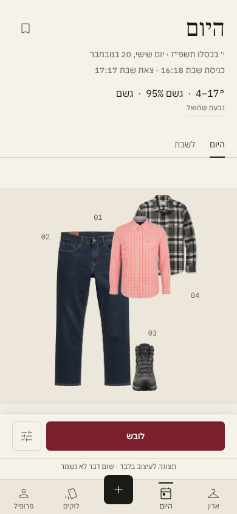
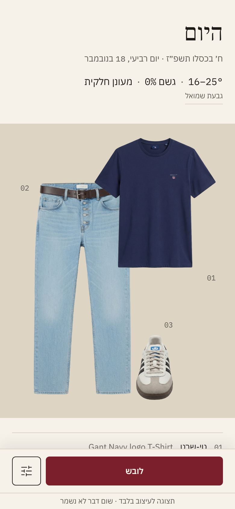
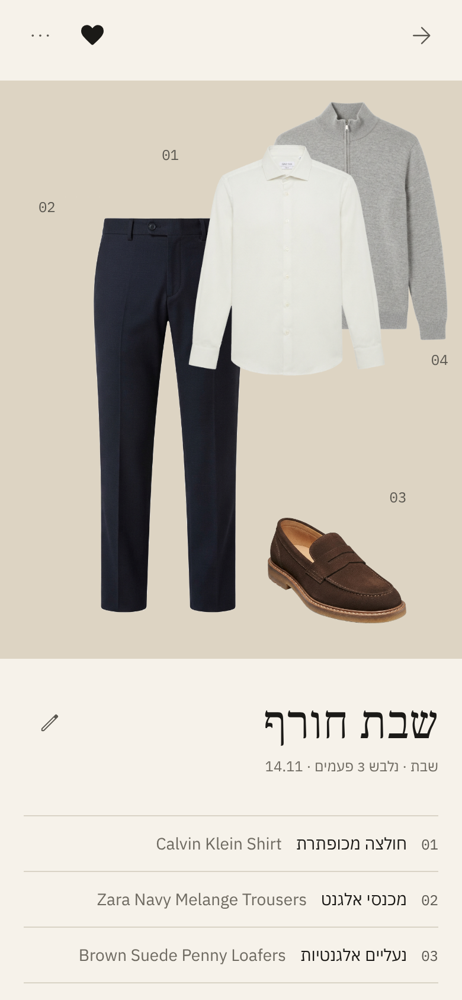
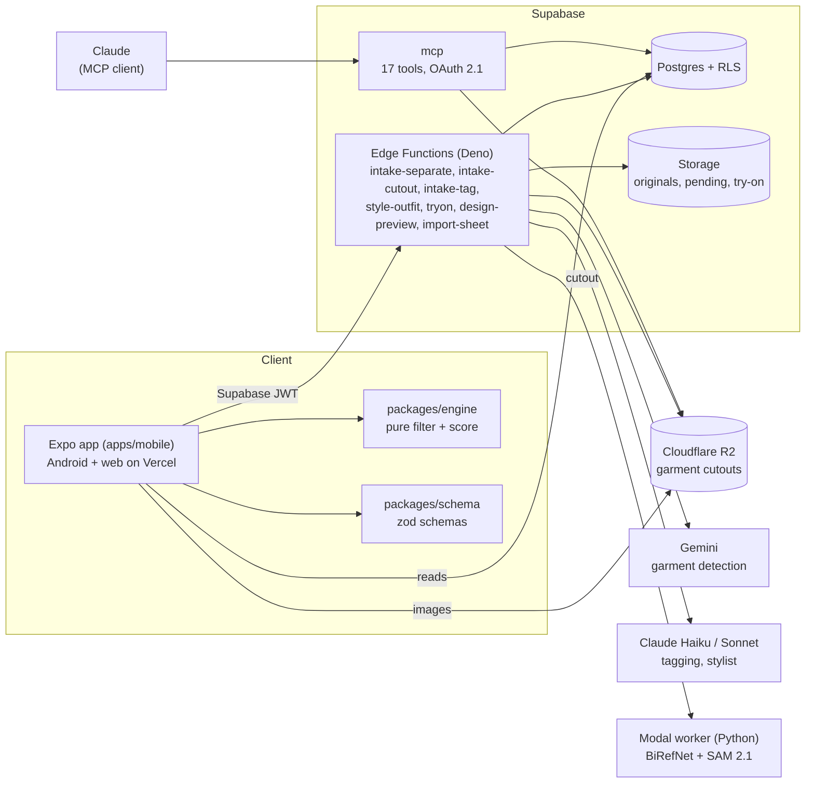

# Fit Check

**A Hebrew-first wardrobe app that turns a photo of your clothes into a tagged digital closet and picks a fitting outfit every day, with an MCP server so Claude can manage the wardrobe too.**

[](https://github.com/Royc4515/fit-check/actions/workflows/ci.yml)
[](https://fit-check-il.vercel.app)
[](https://docs.expo.dev/)
[](tsconfig.base.json)
[](https://supabase.com/)
[](LICENSE)
[](https://github.com/Royc4515/fit-check/commits/main)



<table>
  <tr>
    <td></td>
    <td></td>
    <td></td>
  </tr>
  <tr>
    <td align="center">Today: a rainy Friday, with the Hebrew date and Shabbat times</td>
    <td align="center">Today: an ordinary dry weekday</td>
    <td align="center">A saved outfit with its pieces</td>
  </tr>
</table>

Every screenshot shows the real wardrobe of the app's one user. The band at the bottom marks the read-only design preview the screenshots were taken in.

**Live demo:** <https://fit-check-il.vercel.app> (sign-in with Google; the public page is [/privacy](https://fit-check-il.vercel.app/privacy)).

## Contents

- [About](#about)
- [Tech stack](#tech-stack)
- [Architecture](#architecture)
- [Project structure](#project-structure)
- [Getting started](#getting-started)
- [MCP server](#mcp-server)
- [Roadmap and known limitations](#roadmap-and-known-limitations)
- [Documentation](#documentation)
- [Contributing](#contributing)
- [License](#license)
- [Author](#author)

## About

**The problem.** Most wardrobe apps make you photograph every item on its own, then suggest outfits that ignore the weather. None of them knows that Shabbat and holidays need a different standard of dress, or that the calendar changes what "today" means.

**The solution.** Fit Check takes one photo of a few garments laid flat, separates and tags each one with AI, and then picks the day's outfit with plain, tested code. The language model only chooses among a short list and explains the choice.

- **Photo intake.** One photo of 2-5 garments. Gemini finds each one, the app crops it, a Python worker removes the background, and Claude Haiku tags it against a fixed schema (type, colour, fabric, formality, season, temperature range, modesty flags). You confirm or fix the tags on a review card.
- **Today.** A deterministic engine filters the wardrobe (availability, weather, day rules) and scores the combinations (colour harmony, formality, recent wears, learned pair weights). Claude Sonnet gets **at most 8** candidates, picks one and explains it in Hebrew and English. On a Friday or a holiday eve the screen also plans every day until Havdalah.
- **Feedback loop.** "Wearing", "skip" and "didn't like" adjust the pair weights the engine uses next time.
- **Saved outfits, wear history and insights**, including the month's AI spend.
- **Try-on.** One generated image of the whole outfit on a figure, on request and under a monthly cap.
- **MCP server.** Claude connects over OAuth 2.1 and gets 17 tools to search, edit and add garments and to set the day's context.
- **Hebrew first.** Right-to-left layout, Hebrew and English UI, Hebrew dates and Shabbat times from [Hebcal](https://www.hebcal.com/).

### Design decisions

- **The LLM never sees the whole wardrobe.** Filtering and scoring are code in [`packages/engine`](packages/engine/src); the stylist schema caps the input at 8 candidates, so calls stay cheap and explainable.
- **Every AI answer is validated.** Output is parsed with [zod](https://zod.dev/). On a parse failure the call is logged and the app falls back to the top-scored candidate, so the screen never breaks.
- **Cost is a feature.** Each call writes provider, model, tokens, cost and latency to `ai_calls`. Paid Google calls have a monthly cap in [`budget.ts`](supabase/functions/_shared/ai/budget.ts); when it is reached the feature stops and says so instead of falling back to another paid path.
- **The calendar comes from Hebcal, never computed locally.** Candle-lighting follows the local custom. Today waits at most 2.5 s for the weather or the calendar, then shows a stored answer and says so.
- **The MCP server keeps no personal details.** A context such as "date" or "interview" is stored as a type and a generic label, never a person's name or an event title.

### What broke, and what changed

In November 2026 the garment images used **42.77 GB of cached egress** on Supabase's free tier (quota 5 GB) and the project was restricted. Five causes: no long `cacheControl` on uploads, no on-device image cache, full-size images in grid tiles, reloads on every focus, and up to 100 thumbnails requested at once. The fix: one-year cache headers, `memory-disk` caching, 400 px thumbnails, WebP from the worker, a 30-second reload throttle, 12 thumbnails at a time, and garment images moved to Cloudflare R2 behind [`objects.ts`](supabase/functions/_shared/objects.ts). Details in the [changelog](docs/CHANGELOG.md) (2026-11-22 and 2026-11-24).

## Tech stack

| Layer | Technology |
| --- | --- |
| App (Android + web) | [Expo](https://expo.dev/) SDK 58, [Expo Router](https://docs.expo.dev/router/introduction/), React Native 0.88, React 19, TypeScript strict |
| Styling and motion | [NativeWind](https://www.nativewind.dev/) 4 (Tailwind tokens), [Reanimated](https://docs.swmansion.com/react-native-reanimated/) 4, Gesture Handler |
| i18n | [i18next](https://www.i18next.com/) + react-i18next, Hebrew default, RTL |
| Engine and schemas | Pure TypeScript ([`packages/engine`](packages/engine)), zod ([`packages/schema`](packages/schema)) |
| Backend | [Supabase](https://supabase.com/): Postgres 17 with RLS, Auth (Google), Storage, Edge Functions on [Deno](https://deno.com/) |
| Images | [Cloudflare R2](https://developers.cloudflare.com/r2/) |
| AI | Gemini (garment detection, try-on), Claude Haiku (tagging), Claude Sonnet (stylist) |
| Cutout worker | Python on [Modal](https://modal.com/): BiRefNet via rembg, SAM 2.1 |
| Tooling | pnpm 10 workspaces, [Turborepo](https://turbo.build/), vitest, Deno test, ESLint, GitHub Actions |
| Hosting | [Vercel](https://vercel.com/) (web), EAS (Android APK) |

## Architecture



- The app reads the wardrobe straight from Postgres (row-level security on every table) and runs the engine on the device. Anything that needs a secret or a paid provider goes through an Edge Function.
- Every AI call goes through one function in [`supabase/functions/_shared/ai/`](supabase/functions/_shared/ai) ([README](supabase/functions/_shared/ai/README.md)), is validated with zod and logged to `ai_calls`.
- The `mcp` function runs the same engine as a committed esbuild bundle ([`scripts/bundle-engine.sh`](scripts/bundle-engine.sh)).
- Garment images live in R2; Edge Functions read R2 first and fall back to the Supabase `cutouts` bucket.

## Project structure

```text
.
├── apps/mobile/                 Expo app, also builds the web app
│   ├── src/app/                 routes (Expo Router): tabs, item, outfit, sign-in, oauth consent, privacy
│   ├── src/features/            one folder per screen or flow (today, wardrobe, intake, item, outfits, tryon, ...)
│   ├── src/components/ui/       the component library; screens never style one-off views
│   ├── src/data/                Supabase queries, Hebcal and weather clients, with fixtures
│   └── locales/{he,en}.json     every UI string
├── packages/
│   ├── engine/                  pure filtering, scoring and candidate generation; weights in src/config.ts
│   └── schema/                  zod schemas shared by the app and the Edge Functions
├── supabase/
│   ├── functions/               Edge Functions (Deno); shared code and AI layer in _shared/
│   └── migrations/              forward-only SQL, one file per change
├── worker/                      Modal app (Python): /cutout
├── scripts/                     wardrobe sheet import, seeding, bundling
├── design/screens/              dated screenshots of every screen
└── docs/                        spec, plans, live task status, changelog
```

Key files: [`packages/engine/src/candidates.ts`](packages/engine/src/candidates.ts) (outfit generation), [`packages/engine/src/config.ts`](packages/engine/src/config.ts) (scoring weights), [`packages/schema/src/item-tags.ts`](packages/schema/src/item-tags.ts) (frozen tag schema), [`supabase/functions/style-outfit/index.ts`](supabase/functions/style-outfit/index.ts) (AI stylist), [`supabase/functions/mcp/tools.ts`](supabase/functions/mcp/tools.ts) (MCP tools).

## Getting started

### Prerequisites

- Node.js 22 and pnpm 10.28 (`corepack enable` picks the version from `package.json`)
- [Deno 2](https://docs.deno.com/runtime/getting_started/installation/) for the Edge Function tests
- Optional: the [Supabase CLI](https://supabase.com/docs/guides/local-development/cli/getting-started) for migrations and local functions, the [Modal CLI](https://modal.com/docs/guide) for the worker, and [EAS CLI](https://docs.expo.dev/build/setup/) for Android builds

### Install and configure

```bash
pnpm install
```

```bash
cp .env.example apps/mobile/.env.local
```

Expo reads env files from `apps/mobile`, so the app values go there. The example holds placeholders only; fill in the Supabase URL and publishable key from the Supabase dashboard (Project Settings > API). Real values never go in the repo. Only the three `EXPO_PUBLIC_*` values belong in the app; [`.env.example`](.env.example) lists every other variable, and those are Edge Function secrets set with `supabase secrets set`, never committed.

### Run

```bash
pnpm dev
```

This starts Expo for Android and web. Edge Functions run locally with `pnpm functions:serve`; the web build is `cd apps/mobile && npx expo export --platform web`.

### Test

```bash
pnpm typecheck && pnpm lint && pnpm test
```

```bash
pnpm test:functions
```

Baseline on 2026-11-25: typecheck and lint clean, 834 vitest tests (engine 148, schema 50, app 636) and 50 Deno tests pass. The tests use an anonymized export of the real wardrobe ([`wardrobe.json`](packages/engine/__fixtures__/wardrobe.json)) and recorded Hebcal and weather responses, so they need no keys or network.

## MCP server

The `mcp` Edge Function speaks Streamable HTTP and authenticates with OAuth 2.1 through Supabase Auth. Add it as a connector in Claude with the URL `https://<project-ref>.supabase.co/functions/v1/mcp`.

| Area | Tools |
| --- | --- |
| Wardrobe | `wardrobe_search`, `item_get`, `item_create`, `item_update`, `item_archive`, `item_restore` |
| Images | `item_recrop`, `item_redraw`, `item_recut`, `intake_pending`, `intake_dismiss` |
| The day | `outfit_today`, `outfit_log`, `context_get`, `context_set`, `context_clear` |
| Cost | `spend_summary` |

A ready-made prompt for an assistant that sets the day's context from a calendar is in [docs/mcp/daily-context-workflow.md](docs/mcp/daily-context-workflow.md).

## Roadmap and known limitations

Built and in daily use: intake, wardrobe, Today with the AI stylist, saved outfits, wear history, insights, try-on and the MCP server.

Not built yet or open:

- The morning cron and push: [`generate-daily`](supabase/functions/generate-daily/index.ts) is a stub that returns 501.
- Image embeddings and similarity search: not built (planned on `gemini-embedding-2`, task 5.5 in [docs/TASKS.md](docs/TASKS.md)).
- The pre-purchase check: [`precheck`](supabase/functions/precheck/index.ts) is a stub.
- The MCP server's engine bundle trails the app's engine; it is being rebuilt with a sync test in [Royc4515/fit-check#51](https://github.com/Royc4515/fit-check/pull/51).
- Anyone with the public key can list the legacy Supabase `cutouts` bucket; closing it needs a migration.
- Android gestures, haptics and real writes were verified mostly on the web build. The full list is in [docs/TASKS.md](docs/TASKS.md).

## Documentation

| Document | What it holds |
| --- | --- |
| [docs/PRD.md](docs/PRD.md) | Scope, flows, data model (Hebrew) |
| [docs/DESIGN.md](docs/DESIGN.md) | Visual language, components, motion (Hebrew) |
| [docs/REDESIGN_PLAN.md](docs/REDESIGN_PLAN.md) | Order of the redesign stages |
| [docs/TASKS.md](docs/TASKS.md) | Live task status |
| [docs/CHANGELOG.md](docs/CHANGELOG.md) | What changed, why, and what to look at |
| [docs/PLAN.md](docs/PLAN.md) | The original plan and research (Hebrew) |
| [docs/verification/](docs/verification) | Independent verification reports per stage |
| [docs/REPO_AUDIT.md](docs/REPO_AUDIT.md) | Repository audit of 2026-11-25 |
| [CLAUDE.md](CLAUDE.md) | Working rules for code, design and pull requests |
| [worker/README.md](worker/README.md) | Deploying the Modal worker |

## Contributing

This is a personal project built with [Claude Code](https://docs.anthropic.com/en/docs/claude-code). The rules are in [CLAUDE.md](CLAUDE.md) and summed up in [CONTRIBUTING.md](CONTRIBUTING.md): one thing per pull request, with its spec edit, tests, task row and changelog entry, and an independent check for anything a user can see.

## License

[MIT](LICENSE). The garment photos and screenshots show the author's own wardrobe; the license covers the code and docs.

## Author

Built by Roy Carmelli.

- Portfolio: [roy-carmelli-portfolio.vercel.app](https://roy-carmelli-portfolio.vercel.app/)
- LinkedIn: [in/roy-carmelli](https://www.linkedin.com/in/roy-carmelli)
- GitHub: [@Royc4515](https://github.com/Royc4515)
