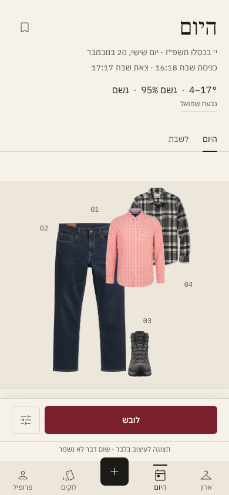
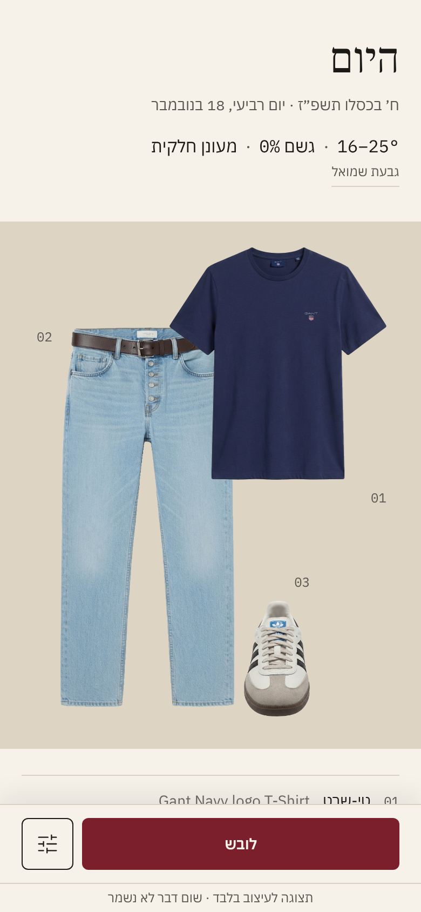
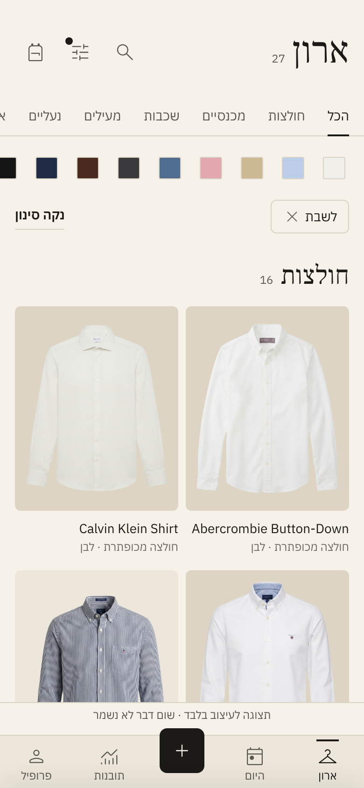
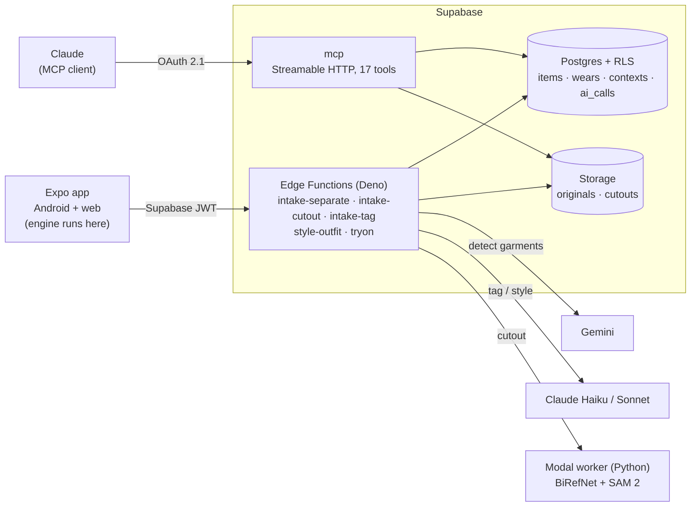

# Fit Check

A personal wardrobe and styling app, Hebrew first, with its own MCP server so Claude can read and manage the wardrobe directly.

You photograph a few garments laid out on a flat surface. The app finds each one, cuts it out and tags it with AI. Every morning it suggests an outfit for the day, based on the weather, Shabbat and the Jewish holidays, and what you wore recently. I built it for myself and use it every day, both in the app and through Claude.

<table>
  <tr>
    <td></td>
    <td></td>
    <td></td>
  </tr>
  <tr>
    <td align="center">Today: a rainy 4-17°C Friday, with the Hebrew date and candle-lighting times</td>
    <td align="center">An ordinary weekday, 16-25°C and dry</td>
    <td align="center">Wardrobe: cutouts grouped by category, colour and occasion filters</td>
  </tr>
</table>

## What it does

- **Photo intake.** One photo of 2-5 garments → Gemini finds each one (box, rough type, problems with the shot) → the app crops it → a Python worker removes the background → Claude Haiku tags it against a fixed JSON schema (type, colour, fabric, formality, season, temperature range, modesty flags). You confirm or fix the tags on a review card.
- **Today.** A deterministic engine filters the wardrobe (availability, weather, day rules) and scores the combinations (colour harmony, formality, recent wears, learned pair weights). Claude Sonnet then gets **at most 8** ranked candidates, picks one and explains the choice in Hebrew and English. On a Friday or the eve of a holiday the screen also plans every day until Havdalah.
- **Feedback loop.** "Wearing", "skip" and "didn't like" are recorded and adjust the pair weights the engine uses next time.
- **MCP server.** Claude (claude.ai connectors or Claude Code) connects over OAuth and gets 17 tools: search the wardrobe, view, create, update or archive garments, log today's outfit, set the day's context (interview, event, date) and read the month's AI spend.

## Architecture



| Part | Where | Stack |
| --- | --- | --- |
| App | `apps/mobile` | Expo Router, TypeScript strict, NativeWind, Reanimated, i18next (he/en, RTL) |
| Styling engine | `packages/engine` | Pure TypeScript: no I/O and no clock, so every test is deterministic. Weights in `config.ts` |
| Shared schemas | `packages/schema` | zod schemas used by the app and the Edge Functions (item tags, stylist input/output, intake) |
| Backend | `supabase/` | Postgres with RLS on every table, Storage, Auth (Google), Edge Functions in Deno, forward-only migrations |
| AI layer | `supabase/functions/_shared/ai` | One function per provider call, zod-validated output, a cost row in `ai_calls` for every call |
| MCP server | `supabase/functions/mcp` | Stateless Streamable HTTP, OAuth 2.1 through Supabase Auth, read-only / destructive hints on the tools |
| Cutout worker | `worker/` | Python on Modal: BiRefNet (rembg) for the matte, SAM 2.1 to keep only the front garment |

## Design decisions

- **The LLM never sees the whole wardrobe.** Filtering and scoring are plain code. The model gets at most 8 candidates (the schema enforces it), so a call stays cheap and the choice can be explained.
- **Every AI answer is validated.** Output is parsed with zod. If parsing fails, the call is logged and the app falls back to the top-scored candidate without an explanation, so the screen never breaks.
- **Cost is a feature.** Each call writes provider, model, tokens, cost and latency to `ai_calls`. Paid Google calls have a monthly cap in code (`budget.ts`). When it is reached the feature stops and says so; it never falls back to another paid path. Image redraws, which cost money, run only on request.
- **Fallbacks where the providers are flaky.** Garment detection tries the paid key, then the free key, then a smaller model, on 429/500/503 or a timeout.
- **The calendar comes from Hebcal, never computed locally.** Candle-lighting follows the local custom (40 minutes in Jerusalem, 30 in Haifa, 20 elsewhere in Israel). The Today screen waits at most 2.5 s for the weather or the calendar, then shows a stored answer and says so.
- **The MCP server keeps no personal details.** A context such as "date" or "interview" is stored as a type and a short generic label, never a person's name or an event title.

## What broke, and what I changed

In November the `cutouts` bucket used **42.77 GB of cached egress** on Supabase's free tier (the quota is 5 GB), and the project was restricted. I traced five causes: uploads without a long `cacheControl` (they defaulted to one hour), images not cached on the device, full-size cutouts loaded in grid tiles, reloads on every screen focus, and up to 100 thumbnails requested at once in the intake queue. The fix: one-year cache headers, `memory-disk` caching, 400 px thumbnails in grids, WebP output from the worker, a 30-second reload throttle and thumbnails loaded 12 at a time. Reads from Cloudflare R2 are also supported when `EXPO_PUBLIC_R2_PUBLIC_URL` is set. Details in `docs/CHANGELOG.md` (2026-11-22).

## Status

Built and in daily use: intake (detect, cutout, tag, review), the wardrobe, Today with the AI stylist, saved outfits, wear history, insights and the MCP server.

Not built yet: the morning cron and push (`generate-daily` is a stub that returns 501), FashionCLIP embeddings and similarity search (the worker endpoint exists but is not wired), and the pre-purchase check (`precheck` is a stub too).

## Running it

```bash
pnpm install
cp .env.example .env.local      # Supabase URL and anon key; AI keys go in Supabase secrets, never in the app
pnpm typecheck && pnpm test     # vitest for packages and app logic, deno test for Edge Functions
pnpm dev                        # expo start (Android + web)
pnpm functions:serve            # Edge Functions locally
```

The tests use an anonymized export of the real wardrobe (`packages/engine/__fixtures__/wardrobe.json`) and recorded Hebcal and geocoding responses, so they run without keys or network.

## How it is built

I build it with Claude Code. `CLAUDE.md` holds the working rules: the spec lives in `docs/PRD.md` and `docs/DESIGN.md`, there is one thing per pull request with its own tests and changelog entry, and every change a user can see is checked by a separate agent that did not write the code, at phone and desktop widths, in Hebrew and English. Screenshots of every screen are in `design/screens/`.

## Docs

- `docs/PRD.md`: scope, flows, data model (Hebrew)
- `docs/DESIGN.md`: visual language and motion (Hebrew)
- `docs/TASKS.md`: live task status
- `docs/CHANGELOG.md`: what changed and why
- `docs/mcp/daily-context-workflow.md`: how a personal AI sets the day's context through MCP
