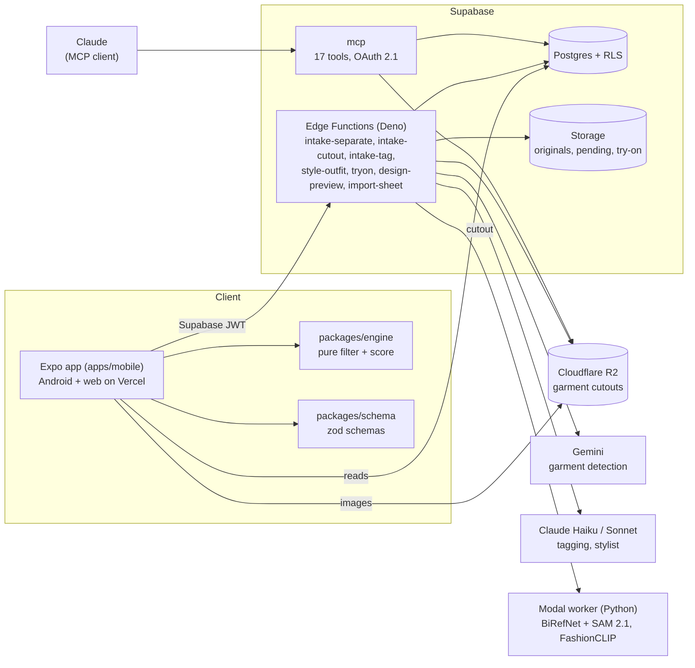

# Repository audit (2026-11-25)

Phase 1 of the repo polish: what the project is, how it runs, what is wrong with the repository, and what to change. Nothing in this file changes code.

## 1. What it is

Fit Check is a personal wardrobe and styling app, Hebrew first and right-to-left. You photograph a few garments laid flat; the app finds each one (Gemini), cuts it out (a Python worker on Modal) and tags it against a fixed schema (Claude Haiku). Every day it proposes an outfit from a deterministic engine that filters and scores the wardrobe by weather, Shabbat and holiday rules and recent wears, then lets Claude Sonnet choose among at most 8 candidates and explain the choice. It runs as an Android app and as a web app on Vercel, and exposes a 17-tool MCP server so Claude can read and manage the wardrobe directly. It has one real user (Roy) and a schema that is ready for more.

## 2. Architecture



- The engine runs in the app (and, as a committed esbuild bundle, inside the `mcp` function). It does no I/O; time and data come in as arguments.
- Every AI call goes through one function in `supabase/functions/_shared/ai/`, is validated with zod and writes a cost row to `ai_calls`.
- Garment images moved to R2 on 2026-11-22 after a Supabase egress overrun; `_shared/objects.ts` reads R2 first and falls back to the Supabase `cutouts` bucket.

## 3. Stack and versions (from the lockfile and configs)

| Part | Version / tool |
| --- | --- |
| Package manager | pnpm 10.28.0 (`packageManager`), turbo ^2.5, `node-linker=hoisted` |
| Node (used for the baseline) | 22.23.5 |
| App | Expo SDK 58 (`expo ~58.0.23`), React 19.3, React Native 0.88.1, Expo Router, NativeWind 4, Reanimated 4.7, TypeScript ~6.0 in the app, ^5.6 in packages |
| Tests | vitest 2 (packages, app), Deno 2 test (Edge Functions) |
| Backend | Supabase (Postgres 17, Auth with Google, Storage, Edge Functions in Deno), 7 forward-only migrations |
| Images | Cloudflare R2 bucket `fit-check-cutouts` |
| Worker | Python on Modal (`worker/app.py`), rembg BiRefNet, SAM 2.1 small, FashionCLIP |
| Web hosting | Vercel, `apps/mobile/vercel.json`, live at <https://fit-check-app-xi.vercel.app> (HTTP 200 on `/` and `/privacy`, 2026-11-25) |
| GitHub | Private repo, homepage set, no description, no topics, no license, no CI workflows |

## 4. Baseline (run on 2026-11-25, branch at `98b7b6c`)

| Step | Command | Result |
| --- | --- | --- |
| Install | `pnpm install --frozen-lockfile` | OK in 6.5 s (pnpm warns that esbuild build scripts are not approved; harmless here) |
| Typecheck | `pnpm typecheck` | 4/4 tasks pass |
| Lint | `pnpm lint` | 4/4 tasks pass, 0 warnings |
| Unit tests | `pnpm test` | 834 pass: schema 50, engine 148, mobile 636 |
| Edge Function tests | `cd supabase/functions && deno test --allow-env --allow-read --allow-net` | 50 pass (Deno is not installed in the cloud image; ran with `npx deno@2`) |
| Web build | `cd apps/mobile && npx expo export --platform web` | Passes when `EXPO_PUBLIC_SUPABASE_URL` and `EXPO_PUBLIC_SUPABASE_ANON_KEY` are set; fails at static render without them (by design, `src/lib` throws) |

## 5. Findings

| # | Severity | Finding | Proposed action |
| --- | --- | --- | --- |
| F1 | high | `supabase/functions/_shared/engine.js` is stale: re-running `scripts/bundle-engine.sh` changes 95 lines. The engine changed on 2026-11-20, the bundle was last built 2026-11-19, so the `mcp` function runs an older engine than the app. | Do not fix here (it changes server behaviour). Open PR #51 (`claude/server-parity`) already rebuilds the bundle and adds a sync test. |
| F2 | high | README "Running it" says `cp .env.example .env.local` at the repo root. Expo reads `.env*` from its project directory (`apps/mobile`), so the app never sees that file; the web export fails without the two `EXPO_PUBLIC_*` vars. | Rewrite the instruction: app vars in `apps/mobile/.env.local`, function secrets with `supabase secrets set`. |
| F3 | medium | Root `.env.example` does not match the code: it lists `MODAL_WORKER_URL` (code reads `MODAL_CUTOUT_URL`) and `HOME_LAT`, `HOME_LON`, `HEBCAL_GEONAMEID` (read nowhere); it lacks `GEMINI_IMAGE_API_KEY`, `DESIGN_PREVIEW_CODE` and the five `R2_*` secrets that `objects.ts` needs. | Rewrite it from the names the code actually reads, grouped by where each one is set. |
| F4 | medium | `CLAUDE.md` says `pnpm test` runs "vitest for packages/*, deno test for functions". It runs vitest only; the 50 Deno tests are run by hand. Its repo layout also omits four functions (`mcp`, `style-outfit`, `tryon`, `design-preview`). | Add a root `test:functions` script and correct both lines in `CLAUDE.md`. |
| F5 | medium | No CI. Nothing runs typecheck, lint or tests on a pull request, although `CLAUDE.md` requires them per PR. | Proposal only (needs your go: GitHub Actions on a private repo uses the free 2,000 min/month quota). |
| F6 | medium | README architecture diagram still shows cutouts in Supabase Storage and lists only 5 functions; R2 is mentioned only as optional reads. | Redraw the diagram (section 2 above) in the new README. |
| F7 | medium | Open PR #51 is based on the pre-`docs/` layout (it edits root `CHANGELOG.md`, `TASKS.md`, `PRD.md`, `DESIGN.md`). Any doc move here adds to its rebase. | Keep moves minimal; say so in the PR. |
| F8 | low | Six verification reports (`docs/redesign-checklist-*.md`) sit beside the spec files and make `docs/` hard to scan. | Move to `docs/verification/`. |
| F9 | low | `docs/KICKOFF_PROMPT.md` is the session-1 prompt from 2026-11-06. It is history, and its setup steps are now wrong (env file location, `MODAL_WORKER_URL`). | Move to `docs/archive/` with a one-line "historical" note, or delete (your call). |
| F10 | low | `design/screens/` holds 536 PNGs, 136 MB; `.git` is 192 MB. Clones are slow, but `CLAUDE.md` requires a screenshot per changed screen and the README uses three. | No change. Git LFS or pruning would rewrite history; listed for you only. |
| F11 | low | Root `.gitignore` misses `*.tsbuildinfo`, `coverage/`, `.vercel/`, `web-build/` (the app's own `.gitignore` covers some of them only under `apps/mobile`). No committed artifacts found. | Add the entries. |
| F12 | low | No `.editorconfig`, no PR template, no `CONTRIBUTING.md`, no `LICENSE`. GitHub description and topics are empty. | Add `.editorconfig`, a PR template that mirrors the `CLAUDE.md` checklist, a short `CONTRIBUTING.md` that points to `CLAUDE.md`. License: your call. |
| F13 | low | The design-preview code path (`design-preview` function, `DESIGN_PREVIEW_CODE`) was due for removal after 2026-11-25 (`docs/TASKS.md`). | Not here: removing it changes behaviour. Listed as a follow-up. |
| F14 | info | Secret scan of the tree and full history (Anthropic, Google, Supabase secret and service-role JWT, GitHub, AWS, private-key patterns): nothing found. The Supabase publishable key was committed in `.env.example` (public by design, but Roy's rule is no real values in env files). | Replaced with placeholders; the key stays in git history. |
| F15 | info | Relative links in all markdown files resolve. No em dashes in docs. | None. |

### Before the repo goes public (Roy, 2026-11-25: "we will open the repo to public")

Making the repo public publishes every file and the whole git history. No secret is exposed (F14), but these personal details are:

| # | Severity | What becomes public | Where | Note |
| --- | --- | --- | --- | --- |
| P1 | medium | Home city (Givat Shmuel) and its coordinates | `.env.example` (`HOME_LAT`, `HOME_LON`), `apps/mobile/src/data/__fixtures__/chain-*.json`, `locales/he.json`, Profile screenshots | City level only, no street address. The `.env.example` lines are unused and can go; fixtures and history keep it. |
| P2 | medium | Religious practice and IDF reserve duty | about 40 lines in `docs/CHANGELOG.md`, `docs/TASKS.md`, `docs/REDESIGN_PLAN.md`, engine rules | It is what the app does (Shabbat and reserve-duty rules); scrubbing it would gut the spec. |
| P3 | low | The full wardrobe list (109 items with notes) | `scripts/data/wardrobe.csv`, `packages/engine/__fixtures__/wardrobe.json` | The engine tests depend on the fixture. |
| P4 | low | Contact email | `apps/mobile/src/app/privacy.tsx`, commit author metadata | Already public on the live privacy page; normal for a public repo. |
| P5 | medium | Supabase project ref and publishable key, next to the known open listing of the `cutouts` bucket (`docs/TASKS.md` "Public listing of the `cutouts` bucket") | `supabase/config.toml`, docs; the key only in git history | The key already ships in the web bundle, so this adds little, but a public repo makes the bucket easier to find. Closing the listing is a migration, outside this PR. |
| P6 | low | Subscription details ("Max 5x"), session-1 setup | `docs/KICKOFF_PROMPT.md` | Another reason to archive or delete it. |

Removing any of this from history needs a history rewrite and a force-push to `main`, which this task will not do. If any item must not be public, the options are: rewrite history before flipping visibility, or publish a fresh repo from a squashed snapshot.

With the repo public, shields.io badges that read GitHub (CI status, last commit, license) work, and a license becomes a real decision (F12).

## 6. Proposed structure

The layout already fits the stack (pnpm workspace, Expo Router `src/app`, Supabase CLI layout, Modal worker). Forcing `src/` or `tests/` at the root would fight Expo, Supabase and turbo, so the changes are confined to `docs/` and root support files.

Before:

```text
.
├── .env.example
├── CLAUDE.md
├── README.md
├── apps/mobile/
├── design/screens/
├── docs/
│   ├── CHANGELOG.md  DESIGN.md  KICKOFF_PROMPT.md  PLAN.md  PRD.md  REDESIGN_PLAN.md  TASKS.md
│   ├── mcp/daily-context-workflow.md
│   └── redesign-checklist-{part1,part2,recheck,stage2,stage3,stage4-part1}.md
├── packages/{engine,schema}/
├── scripts/
├── supabase/{functions,migrations}/
└── worker/
```

After:

```text
.
├── .editorconfig                  new
├── .env.example                   rewritten to match the code
├── .github/pull_request_template.md   new
├── CLAUDE.md                      two factual fixes
├── CONTRIBUTING.md                new, short, points to CLAUDE.md
├── README.md                      rewritten
├── apps/mobile/
├── design/screens/
├── docs/
│   ├── CHANGELOG.md  DESIGN.md  PLAN.md  PRD.md  REDESIGN_PLAN.md  REPO_AUDIT.md  TASKS.md
│   ├── archive/KICKOFF_PROMPT.md
│   ├── assets/                    only if a new screenshot is taken
│   ├── mcp/daily-context-workflow.md
│   └── verification/redesign-checklist-*.md
├── packages/{engine,schema}/
├── scripts/
├── supabase/{functions,migrations}/
└── worker/
```

## 7. Planned moves, renames and deletions

| Path | Action | Reason | References to update |
| --- | --- | --- | --- |
| `docs/redesign-checklist-*.md` (6 files) | `git mv` to `docs/verification/` | Separate reports from the spec | `docs/TASKS.md`, `docs/REDESIGN_PLAN.md`. Old `docs/CHANGELOG.md` entries stay as written (they record the path at the time). |
| `docs/KICKOFF_PROMPT.md` | `git mv` to `docs/archive/` (or delete, your call) | Historical; its setup steps are wrong now | None outside the changelog |
| `docs/PLAN.md` | stays | Six code comments cite it (`adjust.ts`, `candidates.v2.test.ts`, `intake-separate`, `style-outfit`, `explain.ts`, `dayContext.ts`) | - |
| `design/screens/` | stays | Required by `CLAUDE.md`, used by the README | - |
| `supabase/functions/_shared/engine.js` | stays, not rebuilt | Generated on purpose; rebuilding changes server behaviour and PR #51 does it | - |

Deletions: none required. The only candidate is `docs/KICKOFF_PROMPT.md`.

## 8. Open decisions for Roy

1. Branch and PR shape. The task asks for `chore/repo-polish` and one PR; `CLAUDE.md` asks for `claude/<topic>` branches and one thing per PR.
2. License: none (private, all rights reserved) or an open-source one.
3. `docs/KICKOFF_PROMPT.md`: archive or delete.
4. CI on GitHub Actions: yes or not now.
5. GitHub description and topics (values in the checkpoint message).
